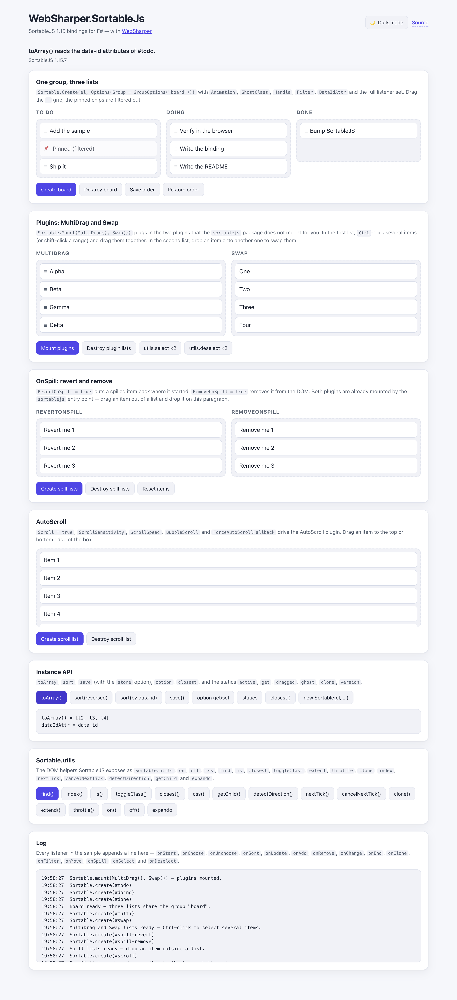

# WebSharper SortableJS API Binding

[](https://www.nuget.org/packages/WebSharper.SortableJs)

An F# [WebSharper](https://websharper.com/) binding for
[SortableJS](https://sortablejs.github.io/Sortable/), the drag-and-drop
reorderable-list library — so you can build sortable lists and boards with
strongly typed F#.

- **SortableJS 1.15.x**, imported as the npm package (`Import`/`ImportDefault`),
  so the sample bundles it with esbuild and there is no CDN `<script>` to add.
- The whole option surface is typed, including the **AutoScroll**, **OnSpill**,
  **MultiDrag** and **Swap** plugin options.
- `Sortable` instances, the statics (`Sortable.Get`, `Closest`, `Create`,
  `Active`, `Dragged`, `Ghost`, `Clone`, `Version`), the `Mount` plugin loader
  and the `Sortable.utils` DOM helpers are all bound.

## Live demos

**Try it live:** [Open the sample in your browser](https://dotnet-websharper.github.io/sortablejs/)



The sample doubles as the binding's [test case](#running-the-test-case): five
lists sharing one group, the MultiDrag and Swap plugins, revert/remove on spill,
a scrollable AutoScroll list, the instance API (`toArray`, `sort`, `save`,
`option`, `closest`), the statics and every `Sortable.utils` helper — with all
listeners logged.

## Repository structure

| Project | Description |
| --- | --- |
| `WebSharper.SortableJs` | The binding (`netstandard2.0`). |
| `WebSharper.SortableJs.Sample` | Static SPA sample, built with esbuild into `dist/`. |

## Install

```bash
dotnet add package WebSharper.SortableJs
```

or, in Paket:

```
nuget WebSharper.SortableJs
```

The binding declares its npm dependency, so the package is pulled in
automatically:

```xml
<NpmDependencies>
  <NpmPackage Name="sortablejs" Version="&gt;= 1.15.7 &lt; 2.0.0" ResolutionStrategy="Max" />
</NpmDependencies>
```

## Usage

```fsharp
open WebSharper
open WebSharper.JavaScript
open WebSharper.SortableJs

[<JavaScript>]
let createBoard () =
    // MultiDrag and Swap have to be mounted before the instances are created.
    // AutoScroll and OnSpill are already mounted by the `sortablejs` entry point.
    Sortable.Mount(MultiDrag(), Swap())

    let el = As<HTMLElement> (JS.Document.GetElementById "todo")

    let sortable =
        Sortable.Create(
            el,
            Options(
                Group = GroupOptions("board", Pull = true, Put = true),
                Animation = 180,
                GhostClass = "sortable-ghost",
                DataIdAttr = "data-id",
                Handle = ".grip",
                MultiDrag = true,
                SelectedClass = "multi-selected",
                MultiDragKey = "CTRL",
                OnEnd = (fun evt ->
                    // `oldIndex`/`newIndex` are `Optional<int>`.
                    let from = if Optional.isDefined evt.OldIndex then string evt.OldIndex.Value else "?"
                    let to' = if Optional.isDefined evt.NewIndex then string evt.NewIndex.Value else "?"
                    JS.Console.Log("moved from " + from + " to " + to')),
                OnSelect = (fun evt -> JS.Console.Log("selected " + evt.Item.TextContent))
            )
        )

    // The instance API.
    sortable.ToArray() |> Array.iter (JS.Console.Log)
    sortable.Sort([| "b"; "a" |], true)
    sortable.Option("animation", box 400)
    sortable.Destroy()
```

Every list in a group shares items:

```fsharp
Options(Group = GroupOptions("board", Pull = [| "board" |], Put = true))
```

### Plugins

The binding imports the package root (`sortablejs`), which is the ES module the
SortableJS docs use. That entry point **mounts AutoScroll and both OnSpill
plugins**, so these options work immediately:

- AutoScroll: `Scroll`, `ScrollSensitivity`, `ScrollSpeed`, `BubbleScroll`,
  `ForceAutoScrollFallback`, `ScrollFn`;
- OnSpill: `RevertOnSpill`, `RemoveOnSpill`, `OnSpill`.

The two heavier plugins are opt-in. Mount them once, **before** creating any
instance that uses them:

```fsharp
Sortable.Mount(MultiDrag(), Swap())
```

```fsharp
Options(MultiDrag = true, SelectedClass = "multi-selected", MultiDragKey = "CTRL",
        AvoidImplicitDeselect = false, OnSelect = …, OnDeselect = …)

Options(Swap = true, SwapClass = "swap-highlight")
```

`MultiDrag` also adds `Sortable.Utils.Select(el)` and
`Sortable.Utils.Deselect(el)`.

### Events

`SortableEvent` extends `Dom.Event` and carries `Item`, `From`, `To`, `Clone`,
`Items`, `Clones`, `OldIndex`/`NewIndex` and
`OldDraggableIndex`/`NewDraggableIndex` (all `Optional<int>`), `PullMode`,
`OriginalEvent`, `SwapItem`, and `OldIndicies`/`NewIndicies` (one
`MultiDragIndex` per multi-dragged item). `OnMove` receives a `MoveEvent` and the
original `Dom.Event`; returning `null` keeps SortableJS's default placement.

### `Sortable.utils`

`Sortable.Utils` is a typed view of the library's helper object: `On`, `Off`,
`Css` (getter and setter overloads), `Find`, `Is`, `Closest`, `ToggleClass`,
`Extend`, `Throttle`, `Clone`, `Index`, `NextTick`, `CancelNextTick`,
`DetectDirection`, `GetChild`, `Expando`, `Select` and `Deselect`.

```fsharp
Sortable.Utils.Css(el, "outline", "2px solid #4f46e5")
let child = Sortable.Utils.GetChild(el, 1, sortable.Options, false)
let direction = Sortable.Utils.DetectDirection(el, sortable.Options) // Direction.Vertical / .Horizontal
```

### Nullability

`Sortable.Active`, `Sortable.Dragged`, `Sortable.Ghost`, `Sortable.Clone`,
`Sortable.Get(el)`, instance `Closest(el, …)` and `utils.Closest(el, …)` can be
`null`/`undefined`; the binding keeps them as reference types, so check with
`isNull (box x)`. `Sortable.Option(name)` returns the raw `obj` — use `As<'T>`
to recover its type.

## Notes

- The binding imports the package root, so a bundle contains a **single** copy of
  Sortable. Do not import `sortablejs/modular/*.esm.js` from application code as
  well: that would duplicate the module and break `Sortable.active` and
  `Sortable.mount`.
- The sample is **light themed by default** and has a light/dark switcher that
  persists the choice in `localStorage`.
- `Sortable.mount` is variadic, so `Sortable.Mount(MultiDrag(), Swap())` emits
  `Sortable.mount(new MultiDrag(), new Swap())` — the form the upstream docs use.

## Running the test case

The sample is a static SPA. Build it, then serve `dist/`:

```bash
dotnet tool install -g dotnet-serve   # once
dotnet tool restore && dotnet paket restore
dotnet build WebSharper.SortableJs.Sample/WebSharper.SortableJs.Sample.fsproj -c Release
dotnet serve -d dist -p 5223
```

Open <http://localhost:5223/>. The page exercises:

- `Sortable.Create`/`new Sortable`/`Sortable.Get` on five lists sharing one
  `GroupOptions` (`Pull`, `Put`, `RevertClone`), with `Animation`, `Easing`,
  `GhostClass`, `ChosenClass`, `DragClass`, `DataIdAttr`, `Draggable`, `Handle`,
  `Filter`, `PreventOnFilter`, `Ignore`, `EmptyInsertThreshold`,
  `SwapThreshold`, `InvertSwap`, `Delay`, `DelayOnTouchOnly`,
  `TouchStartThreshold`, `FallbackOnBody`, `FallbackClass`, `ForceFallback`,
  `SupportPointer`, `SetData` and `Store`;
- the `onStart`, `onChoose`, `onUnchoose`, `onSort`, `onUpdate`, `onAdd`,
  `onRemove`, `onChange`, `onEnd`, `onClone`, `onFilter`, `onMove`, `onSpill`,
  `onSelect` and `onDeselect` listeners (see the log at the bottom);
- `Sortable.Mount(MultiDrag(), Swap())`, `MultiDragKey = "CTRL"` multi-selection
  with `oldIndicies`/`newIndicies`, and Swap with `SwapClass`;
- `RevertOnSpill` (drop outside → item returns) and `RemoveOnSpill` (drop
  outside → item is removed);
- AutoScroll with `Scroll`, `ScrollSensitivity`, `ScrollSpeed`, `BubbleScroll`
  and `ForceAutoScrollFallback`;
- the instance API: `ToArray`, `Sort`, `Save`, `Option` (getter and setter),
  `Closest`, `Destroy`, plus the statics `Active`, `Dragged`, `Ghost`, `Clone`,
  `Version` and `Get`;
- every `Sortable.utils` member: `On`/`Off`, `Css`, `Find`, `Is`, `Closest`,
  `ToggleClass`, `Extend`, `Throttle`, `Clone`, `Index`, `NextTick`,
  `CancelNextTick`, `DetectDirection`, `GetChild`, `Expando`, `Select`,
  `Deselect`;
- persistence: `store.set`, "Save order"/"Restore order" over `localStorage`.

## Build from source

Prerequisites: the .NET 11 SDK (the WebSharper 11 compiler runs on the .NET 11
runtime) and Node.js.

```bash
git clone https://github.com/dotnet-websharper/sortablejs.git
cd sortablejs

# dependencies are managed by Paket
dotnet tool restore
dotnet paket restore

# the binding
dotnet build WebSharper.SortableJs/WebSharper.SortableJs.fsproj -c Release

# the sample: WebSharper output goes to WebSharper.SortableJs.Sample/build,
# then esbuild bundles it into dist/
dotnet build WebSharper.SortableJs.Sample/WebSharper.SortableJs.Sample.fsproj -c Release

dotnet serve -d dist -p 5223
```

## Pack

```bash
dotnet fsi ./build.fsx -t WS-Package
```

The resulting `WebSharper.SortableJs.nupkg` contains the binding assembly (with
its WebSharper metadata sidecar), the XML documentation and the package
dependencies.

## Deployment

`.github/workflows/ghpages.yml` builds the sample in Release and publishes
`dist/` to the `gh-pages` branch with `peaceiris/actions-gh-pages`. The deploy
runs only from the default branch.

## Upstream license (SortableJS)

The binding's own code is Apache 2.0, but the JavaScript library it binds is
licensed differently — **MIT** (SPDX: `MIT`) — for `sortablejs` **1.15.7**,
copyright © 2019 All contributors to Sortable.

- Upstream license: <https://github.com/SortableJS/Sortable/blob/1.15.7/LICENSE>
- Upstream project: <https://github.com/SortableJS/Sortable>

MIT is permissive, not copyleft: it allows commercial and closed-source use, and
there is no obligation to publish your own code. The one requirement is that the
copyright notice and permission notice travel with copies of the library — which
matters when you ship the bundled JavaScript the binding produces (the notice is
included in the npm package and preserved by the bundler's license comments).
The binding itself ships no upstream source, only the npm dependency
declaration.

## License

Apache 2.0 — see [LICENSE.md](LICENSE.md).